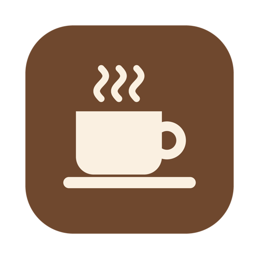
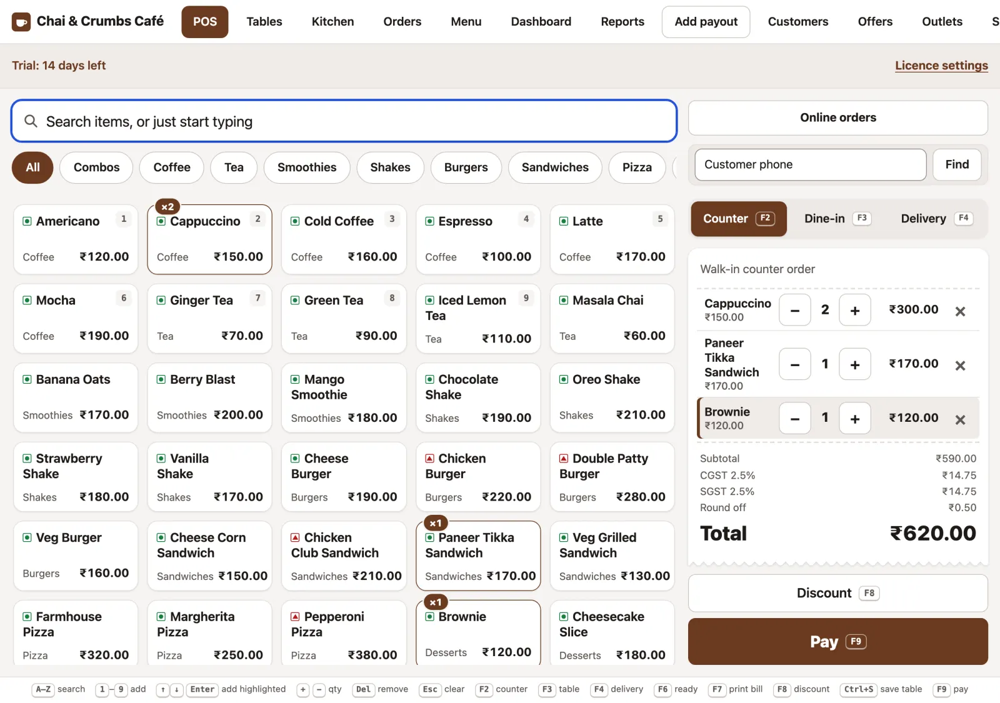
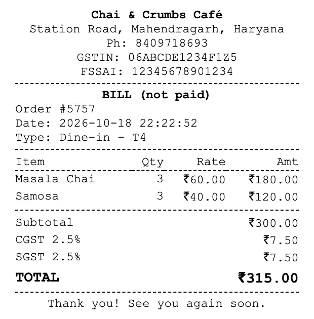
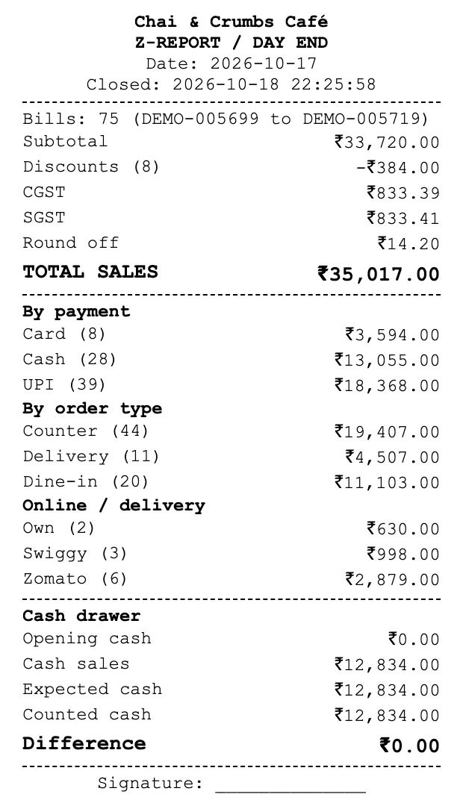
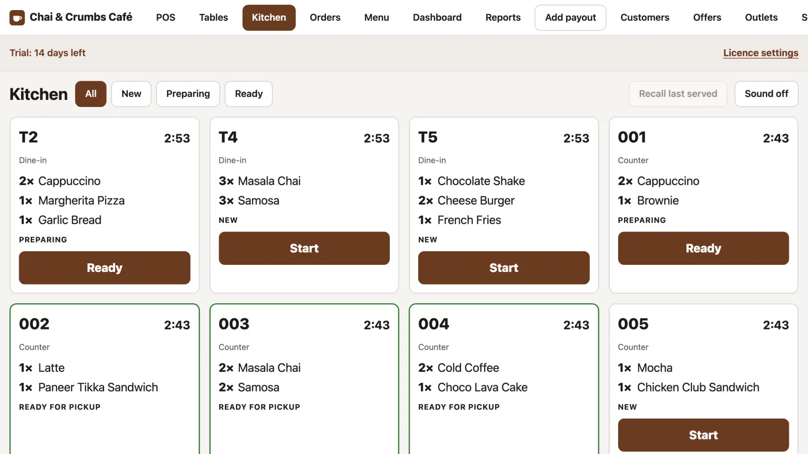
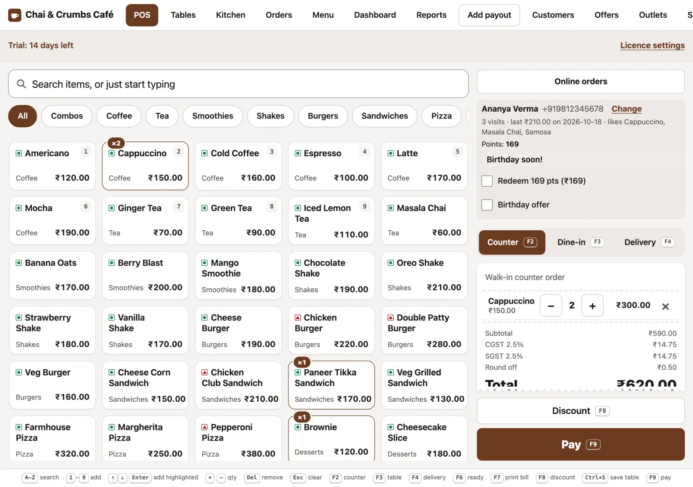
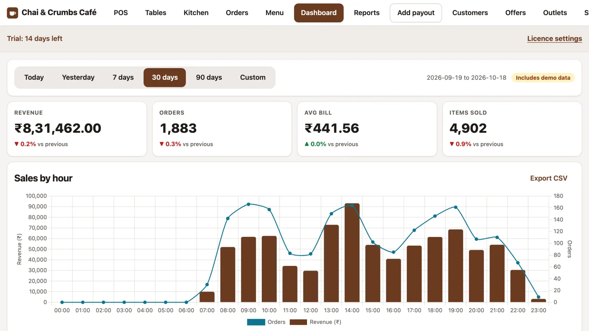

<h1 align="center">TapTill</h1>

<b>Tap, bill, serve. The café till that keeps up with your rush hour.</b>

  Offline point of sale for Indian cafés and small restaurants, for Windows and Mac. 
  <a href="https://jinnu92.github.io/taptill/">Website</a> ·
  <a href="https://jinnu92.github.io/taptill/tour.html">Take the tour</a> ·
  <a href="https://jinnu92.github.io/taptill/download.html">Download</a> ·
  <a href="brochure.pdf">Brochure (PDF)</a> ·
  <a href="https://wa.me/918209718693">WhatsApp</a>

**Your café’s data stays in your café.** TapTill is installed on the computer at your counter. Sales, menu and customer details are stored there, and nothing is uploaded unless you turn on cloud backup or online orders. Billing, the kitchen, printing and reports keep running when the internet is down, and TapTill takes no commission on your sales. Fast touch and keyboard billing, GST bills, KOT, tables, offers, loyalty, stock and daily reports, in one app.

**Try it free for 14 days**: every feature, no key, no card, no sign-up.

## Download

| Computer | File | Link |
|---|---|---|
| Windows 10 or 11 (64-bit) | `TapTill-2.4.0-Setup.exe` | [Download for Windows](https://github.com/jinnu92/taptill/releases/download/v2.4.0/TapTill-2.4.0-Setup.exe) |
| Mac with Apple silicon (M1 or newer) | `TapTill-2.4.0-mac-arm64.dmg` | [Download for Apple silicon](https://github.com/jinnu92/taptill/releases/download/v2.4.0/TapTill-2.4.0-mac-arm64.dmg) |
| Mac with Intel | `TapTill-2.4.0-mac-intel.dmg` | [Download for Intel Mac](https://github.com/jinnu92/taptill/releases/download/v2.4.0/TapTill-2.4.0-mac-intel.dmg) |

All versions are on the [Releases page](https://github.com/jinnu92/taptill/releases/latest). Not sure which Mac you have? Apple menu → About This Mac shows “Chip: Apple …” (Apple silicon) or “Processor: … Intel …”.

## Install

TapTill is new and not yet signed with a paid publisher certificate, so Windows and Mac ask you to confirm the first time. This is expected.

**Windows**

1. Open `TapTill-2.4.0-Setup.exe` from your Downloads.
2. If you see “Windows protected your PC”, click **More info**, then **Run anyway**.
3. Follow the installer, then open **TapTill** from the Start menu or desktop.
4. Set your Admin name and PIN, then add your menu or upload it from Excel.

**Mac**

1. Open the `.dmg` and drag **TapTill** into **Applications**.
2. Open TapTill. If the Mac says it can’t be opened or “Apple could not verify” it, click **Done**.
3. Open **System Settings → Privacy & Security**, scroll down and click **Open Anyway** next to TapTill. Confirm with your Mac password.
4. Click **Open** when asked again. From now on it opens normally.
5. Set your Admin name and PIN, then add your menu or upload it from Excel.

**What you need:** Windows 10/11 (64-bit) or a Mac (Apple silicon or Intel); Google Chrome or Microsoft Edge for silent printing; an 80 mm or 58 mm USB thermal receipt printer installed with its driver (set it as the default printer, then pick 80 or 58 mm in Settings → Printer & KOT). A touchscreen is optional. No internet is needed for daily use.

## Your data, your café

- **Your café’s data stays in your café.** Sales, menu and customer details are stored on your own computer. TapTill doesn’t send your sales data anywhere; nothing is uploaded unless you turn on cloud backup or online orders.
- **Works without internet.** Billing, the kitchen, printing and reports keep running when the internet is down.
- **No commission on your sales.** No per-order or transaction fees charged by TapTill.
- **Pay only for the features you use.** Five plans (Basic, Advanced, Pro, Pro Plus, Enterprise), and add-ons for a lower plan.
- **You own your data.** Export reports and take full backups any time. Encrypted cloud backup is optional and protected by your own password.
- **Staff access is controlled.** Each person has their own PIN and role, and an audit log records discounts, cancellations and changes.
- **Local, personal support** from the developer in Haryana, on WhatsApp.

## Why TapTill

- **Touch or keyboard.** Tap tiles, or just start typing. Number keys add items, F9 pays, F2–F4 switch counter, dine-in and delivery.
- **Indian GST built in.** GST extra or included, CGST and SGST on every bill, GSTIN and FSSAI in the header, round-off, tax invoice and GSTR-1 export.
- **Thermal bills and KOT** on 80 mm or 58 mm printers, or kitchen tickets on a screen.
- **Windows and Mac.** Start billing the same day.

## Features

A tag shows the lowest plan with the feature: **(Advanced)**, **(Pro)** or **(Pro Plus)**. Features without a tag are in every plan.

### Billing at the counter
- Counter, dine-in and delivery orders from one screen, by touch or keyboard
- Modifiers and variants (sizes, add-ons, kitchen notes), printed on the KOT and bill
- Split payment across cash, UPI and card
- UPI QR on the bill and customer display, with the exact amount
- Advance orders with pickup time and advance payment (Advanced)
- Print the bill before payment, discounts by amount or percent, audit log

### GST bills, tax invoice and GSTR-1
- GST extra or included in price, CGST/SGST split, round-off to the rupee
- Tax invoice format with legal name, GSTIN, state, HSN/SAC, taxable value per rate and amount in words, or “Bill of supply”
- Bill numbers by financial year (for example `CAFE/25-26/00001`) and per-item GST rate
- GSTR-1 export: monthly B2C summary by rate and HSN summary as CSV

 

### Tables, kitchen and self-ordering
- Tables at a glance: running bill, time seated and kitchen status
- Table service status: seated, ordered, served, bill requested, with timers (Pro)
- Table QR self-ordering on the café Wi-Fi; staff accept each order, guests only see their own table (Pro)
- KOT printed, on a kitchen screen, or both; only new items go on the next KOT
- Kitchen screen with Start and Ready, amber and red timers (Advanced)
- Customer display on any TV with offers and ready order numbers (Advanced), and a menu board mode (Pro)

### Offers, loyalty and feedback
- Offers and combos: fixed-price combos, happy hours, buy X get Y with a free-item suggestion, display promos (Advanced)
- Customer loyalty with points or stamps, looked up by phone number at the till (Pro)
- Birthday and anniversary offers (Pro), customer list with history and CSV export
- Feedback and ratings from a QR on the bill, with reports by day, item and staff (Pro)

### Reports, cash drawer and profit
- Dashboard for today, 7, 30 or 90 days or any dates, compared with the period before
- What sells when (morning, afternoon, evening, night) and a busy-hours heatmap
- Advanced reports (Advanced): best sellers, daily sales, staff sales, discounts and cancellations, day-end Z-report, CSV export
- Cash drawer: opening cash, payouts, expected cash, count by notes, UPI and card tick list
- Cash in and cash out: opening cash count at the start of the day, note count at day close
- Owner's Today screen and quick search (Ctrl+K)
- Expenses and profit, daily and monthly (Advanced)
- CA export: monthly or yearly ZIP with the sales register, GSTR-1 (B2C and HSN), cancellations, discounts, Z-reports, expenses, purchases with supplier GSTIN and online orders kept separate; CSV and Excel, optional password, customer data never included
- Accountant role and Tally XML export (Pro; an add-on for lower plans)

### Stock and recipe costing (Pro)
- Ingredients in g, ml or pieces with reorder levels and average cost
- Recipes per item, including combos and modifiers; stock comes off when a bill is paid
- Purchases from suppliers, wastage, stock count, low-stock list, food cost %, Excel import
- Store manager role: purchases with a bill photo, returns, wastage, counts, purchase orders over WhatsApp and supplier dues; big entries wait for the owner's approval

### Staff, devices and online orders
- Own PIN for every user, auto-lock, roles (Admin, Cashier, Order taker, Kitchen, plus Store manager and Accountant on Pro), audit log; users per plan: Basic 2, Advanced 6, Pro 15, Pro Plus and Enterprise unlimited
- Staff attendance: clock in and out with a PIN, hours and sales per shift (Advanced)
- Phones and tablets on the café Wi-Fi, paired once (Advanced)
- Swiggy and Zomato orders through an integration partner; needs your own partner account and internet for those orders (Pro)

### Safe and up to date
- Daily automatic backups, plus a copy to USB or a cloud-synced folder; restore in a few clicks
- Encrypted cloud backup with your own password, uploaded by your Google Drive or OneDrive app (Pro)
- Multi-outlet reports from signed day files, no server needed (Pro Plus)
- Signed offline updates, with a backup taken first
- Six colour themes or your own brand colour, light or dark
- One-click help file for support, with no orders, customers, menu or prices in it

## Plans

| Feature | Basic | Advanced | Pro | Pro Plus | Enterprise |
|---|:---:|:---:|:---:|:---:|:---:|
| Who it is for | Small café, one counter | Busy café with staff and a kitchen | Control of stock, customers and books | Growing café, 2 or 3 outlets | Chains and franchises |
| Users | 2 | 6 | 15 | Unlimited | Unlimited |
| Paired phones and tablets | 0 | 2 | 5 | 10 | 10 per outlet |
| Outlets in HQ reports | 1 | 1 | 1 | 3 | Unlimited |
| Billing, tables, KOT, modifiers, split payment, UPI QR, GST invoice, GSTR-1 | ✓ | ✓ | ✓ | ✓ | ✓ |
| Day close, Z-report, cash drawer, cash in and out, dashboard, backups, updates, themes | ✓ | ✓ | ✓ | ✓ | ✓ |
| CA export (CSV and Excel) | ✓ | ✓ | ✓ | ✓ | ✓ |
| Phones and tablets, kitchen screen, customer display | – | ✓ | ✓ | ✓ | ✓ |
| Offers and combos, Excel menu import, advanced reports | – | ✓ | ✓ | ✓ | ✓ |
| Expenses and profit, advance orders, staff attendance | – | ✓ | ✓ | ✓ | ✓ |
| Swiggy and Zomato orders (partner account needed) | – | add-on | ✓ | ✓ | ✓ |
| Inventory, recipes, food cost, Store manager role, supplier ledger, purchase orders | – | – | ✓ | ✓ | ✓ |
| Loyalty, feedback, table QR self-ordering, table service, menu board | – | – | ✓ | ✓ | ✓ |
| Accountant role, bill questions, Tally XML | add-on | add-on | ✓ | ✓ | ✓ |
| Encrypted cloud backup | add-on | add-on | ✓ | ✓ | ✓ |
| Multi-outlet day files and HQ reports | – | – | – | ✓ (up to 3) | ✓ |
| Custom branding on receipts and customer display | – | – | – | ✓ | ✓ |
| Priority support and onboarding | – | – | – | ✓ | ✓ |
| Central licence management for all outlets | – | – | – | – | ✓ |

Add-ons can go on a lower plan: Swiggy and Zomato, Accountant and Tally, cloud backup, extra phones and tablets, and extra users.

**Pricing:** contact us for pricing. Pay only for the features you use, with no commission on your sales. The 14-day trial includes every feature (Enterprise).

## How licensing works

1. **Install** TapTill on your counter laptop.
2. **Try** every feature free for 14 days.
3. **Choose** a plan, and send us the Installation ID from Settings → Licence.
4. **Activate** with the key we send back. It works offline and is tied to that laptop.
5. **Renew** with a new key before the end date. Bills and menu stay as they are.

You get reminders from 15 days before the end date, then 7 days of grace. After that TapTill becomes read-only: no new bills, but reports, reprints, exports and backups still work. Nothing is deleted. Changing laptops? Send the new Installation ID and we issue a key with the same end date.

## FAQ

**Does TapTill need internet?** No. Billing, KOT, printing, tables, reports and backups run on your computer and keep running when the internet is down. Phones and tablets connect through your café Wi-Fi router without internet; we recommend a separate guest Wi-Fi for customers. Only Swiggy/Zomato orders (with your partner account) and cloud backup uploads need internet.

**Where is my data stored?** On the computer where TapTill is installed: `~/Library/Application Support/TapTill` on a Mac, `%APPDATA%\TapTill` on Windows. The folder is kept when you uninstall or update. Backups are taken every day at a time you choose.

**Do you take a commission on my sales?** No. There are no per-order or transaction fees from TapTill.

**Is it GST ready?** Yes: CGST/SGST on every bill, GSTIN and FSSAI, round-off, tax invoice format with HSN/SAC, and GSTR-1 B2C and HSN summaries as CSV.

**Which printers work?** 80 mm or 58 mm USB thermal receipt printers that install as a normal printer on Windows or Mac. With Chrome or Edge installed, bills and KOTs print without a dialog.

**Swiggy and Zomato?** On Pro and above (an add-on on Advanced), through an integration partner. You need your own partner account, and internet for those orders.

**Is my data safe?** Data stays on your laptop, with a daily backup (last 30 kept) and optional copies to USB or a cloud folder. Encrypted cloud backup (Pro and above) uses your password; without it the cloud copy cannot be opened. Uninstalling does not delete your data.

**Can waiters use phones?** On Advanced and above. Pair each phone or tablet once from Settings; they work over your café Wi-Fi.

**First launch shows a security warning?** Windows: **More info → Run anyway**. Mac: **System Settings → Privacy & Security → Open Anyway**. Only the first time.

## Contact

**Praveen Kumar** · Mahendragarh, Haryana

- WhatsApp / Phone: [8209718693](https://wa.me/918209718693)
- Email: [jinnu92@gmail.com](mailto:jinnu92@gmail.com)
- Website: [jinnu92.github.io/taptill](https://jinnu92.github.io/taptill/) · [Tour](https://jinnu92.github.io/taptill/tour.html) · [Brochure (PDF)](brochure.pdf)

Screenshots show a demo café, “Chai & Crumbs Café”, with sample data.
